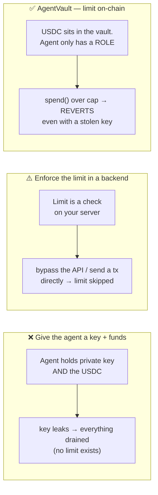
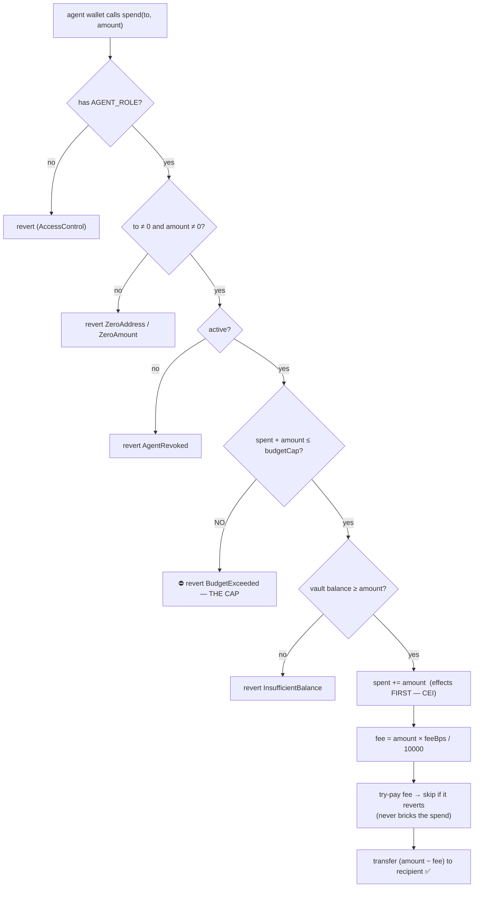
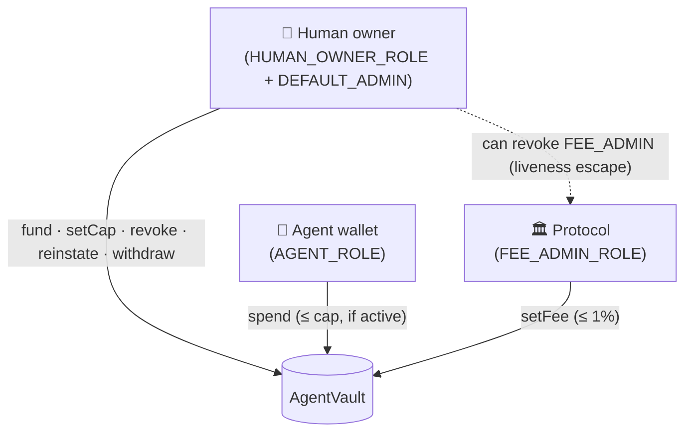
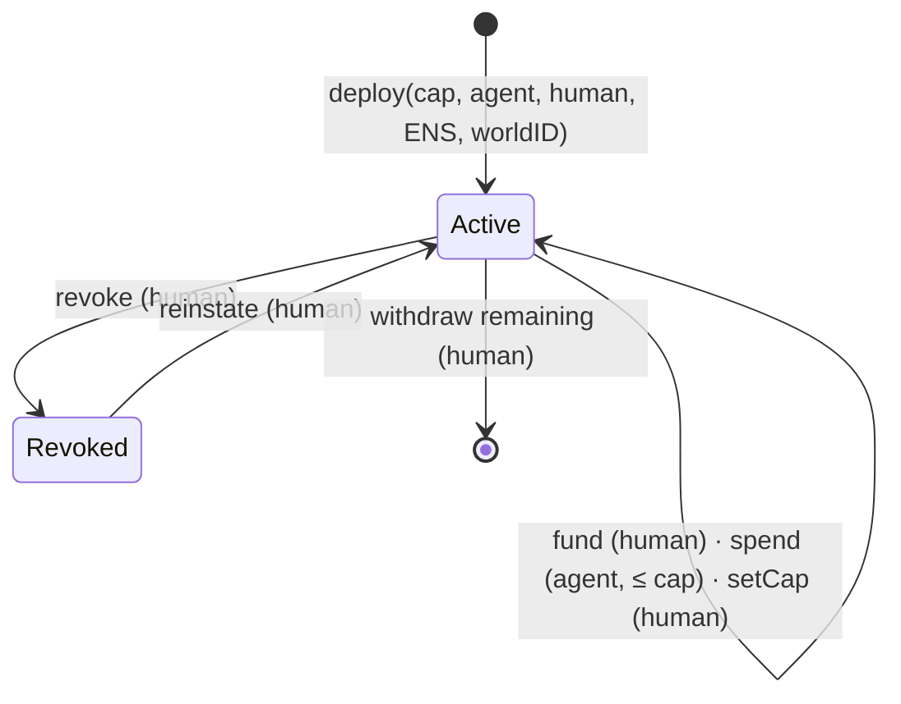
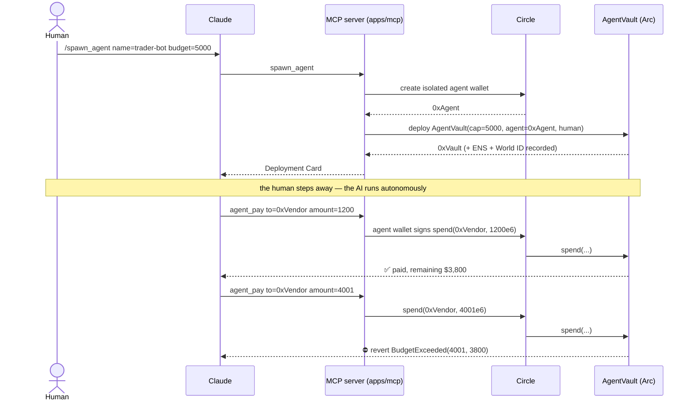
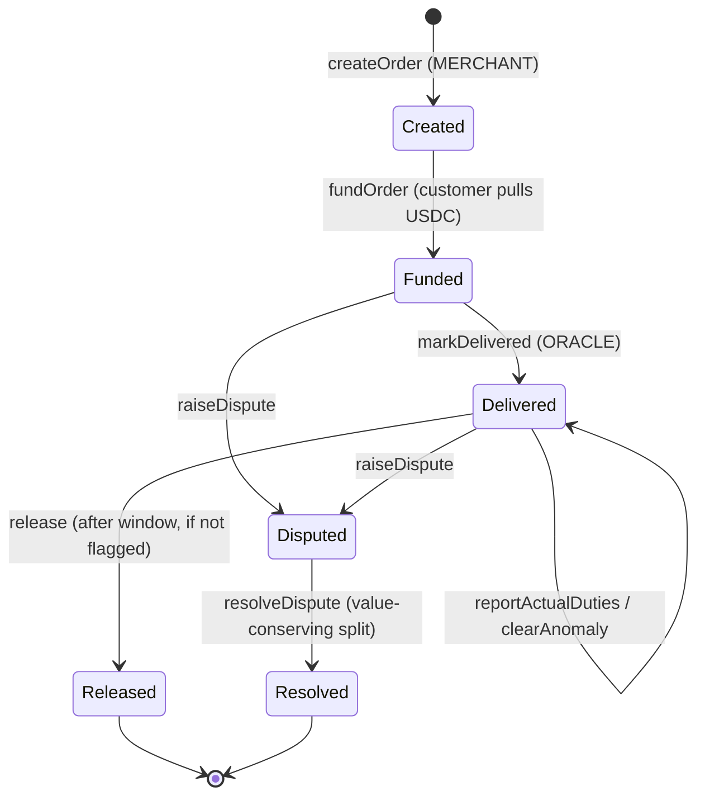

# StableSettle — Smart Contract Reference

Two contracts in `packages/contracts/src/`:

| Contract | Role | This doc |
|---|---|---|
| **`AgentVault.sol`** | 🥇 The budget-capped AI treasury — **the spend-limit contract** | Part 1 |
| **`StableSettleEscrow.sol`** | The settlement engine the agent pays *through* | Part 2 |
| `MockUSDC.sol` / `MockEURC.sol` | 6-decimal ERC-20s with public `mint()` for a self-contained demo | — |

---
---

# Part 1 · `AgentVault` — the spend-limit contract

## Why it needs to exist

The whole project answers one question: **how do you give an AI agent money it can spend autonomously, but cannot overspend?**

The naive answers all put the limit *outside the money*, where it can be bypassed:



**The core design idea:** the agent never holds the funds. The USDC lives inside the `AgentVault` contract. The agent's wallet is only granted **permission to *request* a spend** (`AGENT_ROLE`). The contract decides whether that spend is allowed — and the rule is a Solidity `require`, not a dashboard setting.

> Even if the agent's wallet key is fully compromised, the attacker can spend **at most the remaining budget**, then every further `spend()` reverts.

---

## How the spend limit works

Three storage variables hold the entire limit:

```solidity
uint256 public budgetCap;   // lifetime ceiling, set by the human
uint256 public spent;       // cumulative spend, only ever increases
bool    public active;      // human can flip this off to freeze the agent
```

The invariant the contract guarantees, after **any** sequence of calls:

```
spent  is monotonically non-decreasing
spent  ≤  budgetCap      (always)
```

That's enforced in one place — `spend()` — which runs these checks **before any money moves**:



The actual code — small on purpose:

```solidity
function spend(address to, uint256 amount) external onlyRole(AGENT_ROLE) nonReentrant {
    if (to == address(0)) revert ZeroAddress();
    if (amount == 0) revert ZeroAmount();
    if (!active) revert AgentRevoked();

    uint256 remaining = budgetCap - spent;
    if (amount > remaining) revert BudgetExceeded(amount, remaining); // ← the limit

    uint256 bal = token.balanceOf(address(this));
    if (amount > bal) revert InsufficientBalance(amount, bal);

    spent = spent + amount;                 // effects BEFORE interaction (CEI)
    // … value-conserving, non-bricking protocol fee …
    token.safeTransfer(to, amount - fee);
}
```

Why this ordering matters (the build logic):

1. **Role check first** (`onlyRole(AGENT_ROLE)`) — only the one wallet the human authorized can even call this.
2. **Cap check before balance check** — the *budget* is the product promise; we revert with the meaningful `BudgetExceeded` error, not a generic transfer failure.
3. **`spent` updated before the transfer** (checks-effects-interactions) — a re-entrant call sees the already-incremented `spent` and can't double-spend. `nonReentrant` is belt-and-suspenders.
4. **`spent` counts the full `amount`**, fee or no fee — so the fee can never let the agent sneak extra value past the cap.

---

## Who can do what (roles)



| Role | Can call | Cannot |
|---|---|---|
| `HUMAN_OWNER_ROLE` (the human) | `fund`, `setCap`, `revoke`/`reinstate`, `withdraw` | `spend` — the human delegates spending to the agent |
| `AGENT_ROLE` (the AI wallet) | `spend` (only ≤ remaining budget, only while `active`) | change the cap, withdraw, revoke |
| `FEE_ADMIN_ROLE` (protocol) | `setFee` | touch funds or the budget |
| `DEFAULT_ADMIN_ROLE` (human) | manage roles — **including revoking a misbehaving fee admin** | — |

The human keeps two escape hatches at all times: **`revoke()`** (freeze the agent instantly) and **`withdraw()`** (pull the funds out). It is their vault.

---

## Vault lifecycle



One vault is deployed **per agent**. The constructor also records the agent's **ENS name** and the human's **World ID nullifier** on-chain (event `VaultDeployed`) as provenance for the "human-backed, compliant agent" claim.

---

## The protocol fee (optional, safe by construction)

A value-conserving fee on each spend — built so it can earn revenue without ever endangering the agent:

- **Off by default** (`feeBps = 0`); capped at `MAX_FEE_BPS = 100` (1%).
- **Value-conserving:** the recipient nets `amount − fee`, the protocol gets `fee`, and the **full `amount`** counts against the budget.
- **Non-bricking:** if the fee transfer fails (e.g. the recipient lands on a USDC blacklist), the fee is *skipped* and the payee still gets paid — a hostile fee recipient can never freeze spending.
- **Owner-governable:** `FEE_ADMIN_ROLE` is managed by the human (`DEFAULT_ADMIN_ROLE`), so the human can revoke a misbehaving fee admin. The fee is cooperative, not a lock on the user's own money.

---

## How the MCP server connects to the contract

The contract is the *enforcement*. The **MCP server (`apps/mcp`) is the interface** — it lets Claude drive the vault in plain language, and it owns the off-chain pieces (wallet creation, ENS, World ID) that a contract can't do.

Each of the six MCP tools maps to the contract:

| MCP tool | Contract touchpoint | What the server adds around it |
|---|---|---|
| `spawn_agent` | **deploys** `AgentVault` (constructor, incl. `ownerPayout`) + `setDailyLimit` / optional `setMaxPerSpend` | creates the isolated **Circle** wallet, verifies **World ID**, issues the **ENS** subname; applies a default 24h velocity limit; owner + payout come from server config, never a tool argument |
| `agent_pay` | calls **`spend()`** (agent wallet signs via Circle) | validates the recipient address, converts dollars → USDC units |
| `agent_pay_x402` | calls **`spend()`** to pay an x402 toll | runs the HTTP 402 round-trip, enforces a willingness ceiling, returns the purchased data |
| `fund_agent` | calls **`fund()`** (deployer approves + funds) | tops up the vault treasury; checks the deployer balance first |
| `topup_gas` | ERC-20 `transfer` to the agent wallet | sends the agent USDC for gas (USDC is gas on Arc); reports the new wallet balance |
| `get_agent` | reads `budgetRemaining` / `spent` / `balance` / `active` / `maxPerSpend` / `dailyLimit` | renders the status card |



**Why a contract *and* an MCP server (why not just the server)?** Because if the limit lived only in the MCP server, it would be the "backend limit" from the first diagram — bypassable. The MCP server holds no veto over the money; it just relays the agent's signed request. The **contract** is what an attacker (or a buggy agent) runs into. The server makes it usable; the contract makes it safe.

---

## Security properties (AgentVault)

- `SafeERC20` on every token move; `ReentrancyGuard` on `spend` / `fund` / `withdraw`.
- **Checks-effects-interactions:** `spent` is written before any transfer.
- **Cap invariant:** `spent ≤ budgetCap` holds after any call sequence; `setCap` can never drop below `spent` (`CapBelowSpent`).
- **Daily velocity limit (opt-in):** an optional rolling 24h ceiling (`setDailyLimit`, default off) reverts with `DailyLimitExceeded` and resets when the window elapses — a hijacked agent can't burst-drain even under the lifetime cap.
- **On-chain health view:** `health()` returns `(status, capRemaining, todayRemaining)` for backend-free monitoring.
- **Non-bricking fee:** fee collection failure can't block a spend.
- **Owner liveness:** `revoke()` and `withdraw()` are always available to the human.
- **Custom errors:** `BudgetExceeded` · `DailyLimitExceeded` · `InsufficientBalance` · `AgentRevoked` · `CapBelowSpent` · `FeeTooHigh` · `FeeRecipientZero` · `ZeroAddress` · `ZeroAmount`.

**Tests:** `packages/contracts/test/AgentVault.t.sol` — **56 passing**, covering the over-budget revert, the daily-limit revert + window reset, the `health()` states, underfunded vault, cap changes, revoke/reinstate, the withdraw-only-to-`ownerPayout` lock (including a compromised-owner-key case), the recipient allowlist (not-allowed reverts even under budget; agent can't edit it), the value-conserving fee, the non-bricking fee (hostile recipient), and access control. Verified end-to-end against a live node by `bun run --filter='@stablesettle/mcp' e2e:local`.

> ⚠️ Unaudited testnet code. These properties raise the floor; a mainnet launch needs a professional audit.

---
---

# Part 2 · `StableSettleEscrow` — the settlement engine

The agent pays *through* this contract. It turns one order into a four-bucket programmable escrow with a dispute branch, settling in USDC **or** EURC. Intentionally small: **6 states, 8 functions, 8 events, 3 roles**, plus a duties-anomaly flag on `Delivered`.

## Deployment

```solidity
constructor(IERC20 settlementToken, address admin)
```

- `settlementToken` — the ERC-20 used for every transfer (USDC: 6 decimals on Arc). `immutable`, so the same bytecode serves the mock-token demo and real-USDC settlement.
- `admin` — granted `DEFAULT_ADMIN_ROLE` + all three functional roles for the demo. In production, split these and make `ADMIN_ROLE` a multisig.

| | Value |
|---|---|
| Network | Arc Testnet (chain id `5042002`) |
| Arc USDC | `0x3600000000000000000000000000000000000000` (6 decimals) |
| Explorer | https://testnet.arcscan.app |

Addresses are written to `apps/web/src/deployments.json` by the deploy script.

## States



| # | State | Meaning |
|---|---|---|
| 0 | `Created` | Order registered; not yet funded. |
| 1 | `Funded` | Customer's USDC is in escrow, split into four buckets. |
| 2 | `Delivered` | Oracle reported delivery; refund window counting down. |
| 3 | `Released` | Window elapsed; all four buckets paid out. Terminal. |
| 4 | `Disputed` | Package refused; funds frozen pending admin resolution. |
| 5 | `Resolved` | Admin paid out an explicit value-conserving split. Terminal. |

## Data structures

```solidity
struct Split {
    address merchant; address creator; address platform; address customer;
    uint256 merchantAmount; uint256 refundReserve; uint256 creatorCommission; uint256 platformFee;
}

struct Order {
    uint256 totalAmount; uint256 deliveredAt; uint256 refundWindowSeconds;
    uint256 estimatedDuties; uint256 actualDuties; address token;
    OrderState state; bool settled; bool anomalyFlagged; Split split;
}
```

Orders are keyed by a caller-supplied `bytes32 orderId`. Display fields (`productName`, `customerCountry`) are **emitted**, not stored.

## Functions

| Function | Caller | State in → out | Notes |
|---|---|---|---|
| `createOrder(...)` | `MERCHANT_ROLE` | — → `Created` | Four bucket amounts must sum **exactly** to `totalAmount`. `token = address(0)` uses USDC. |
| `fundOrder(orderId)` | anyone (customer) | `Created` → `Funded` | Pulls `totalAmount` via `safeTransferFrom`. `nonReentrant`. |
| `markDelivered(orderId)` | `ORACLE_ROLE` | `Funded` → `Delivered` | Sets `deliveredAt`. **Simulated oracle** in the MVP. |
| `reportActualDuties(orderId, actual)` | `ORACLE_ROLE` | `Delivered` (no change) | Auto-flags if `actual > estimated × 2`. |
| `clearAnomaly(orderId)` | `ADMIN_ROLE` | `Delivered` (no change) | Clears the flag after review. |
| `release(orderId)` | anyone | `Delivered` → `Released` | Requires window elapsed **and** `!anomalyFlagged`. `nonReentrant`. |
| `raiseDispute(orderId)` | `ORACLE_ROLE` or `customer` | `Funded`/`Delivered` → `Disputed` | Freezes the order. |
| `resolveDispute(orderId, toCustomer, toMerchant, toCreator, toPlatform)` | `ADMIN_ROLE` | `Disputed` → `Resolved` | Four payouts must sum **exactly** to `totalAmount`. `nonReentrant`. |

Views: `getOrder(bytes32) → Order` · `orderExists(bytes32) → bool`.

## Events (the audit log)

The dashboard reconstructs the full audit log from these — that's why **no backend DB is needed**. `orderId` is indexed on every event: `OrderCreated`, `OrderFunded`, `Delivered`, `ActualDutiesReported`, `AnomalyCleared`, `Released`, `DisputeRaised`, `DisputeResolved`.

## Roles

| Role | Capability |
|---|---|
| `MERCHANT_ROLE` | `createOrder` |
| `ORACLE_ROLE` | `markDelivered`, `reportActualDuties`, `raiseDispute` |
| `ADMIN_ROLE` | `resolveDispute`, `clearAnomaly` |

## Security properties (escrow)

- `SafeERC20` everywhere; `ReentrancyGuard` on `fundOrder`, `release`, `resolveDispute`.
- Checks-effects-interactions; `settled` + precise prior state guard double-spend (`InvalidState`).
- **Value-conservation invariant** on `createOrder` (buckets sum == total) and `resolveDispute` (payouts sum == total) — no minting, no trapped funds (`SplitMismatch`).
- Zero-value bucket transfers skipped to avoid reverts on strict tokens.

## Duties anomaly (Scenario C)

Not a separate state — a flag on `Delivered`: `reportActualDuties` auto-flags when `actual > estimated × 2`; while flagged, `release()` reverts with `AnomalyFlaggedRelease`; an admin `clearAnomaly()`s after review, then `release()` proceeds. `estimatedDuties = 0` opts an order out entirely.

## A real on-chain constraint

You **cannot** fast-forward `block.timestamp` on a live testnet, so the demo uses `refundWindowSeconds = 0` and production uses 7–14 days. There is deliberately no "fast-forward" function — it would be meaningless on-chain.

## Tests

`packages/contracts/test/StableSettleEscrow.t.sol` — **35 passing**, plus a stateful invariant run: all three scenarios end-to-end, role/state gating, double-spend reverts, multi-currency (EURC) settlement, and the value-conservation invariant. **92 tests pass repo-wide** (`forge test`).
