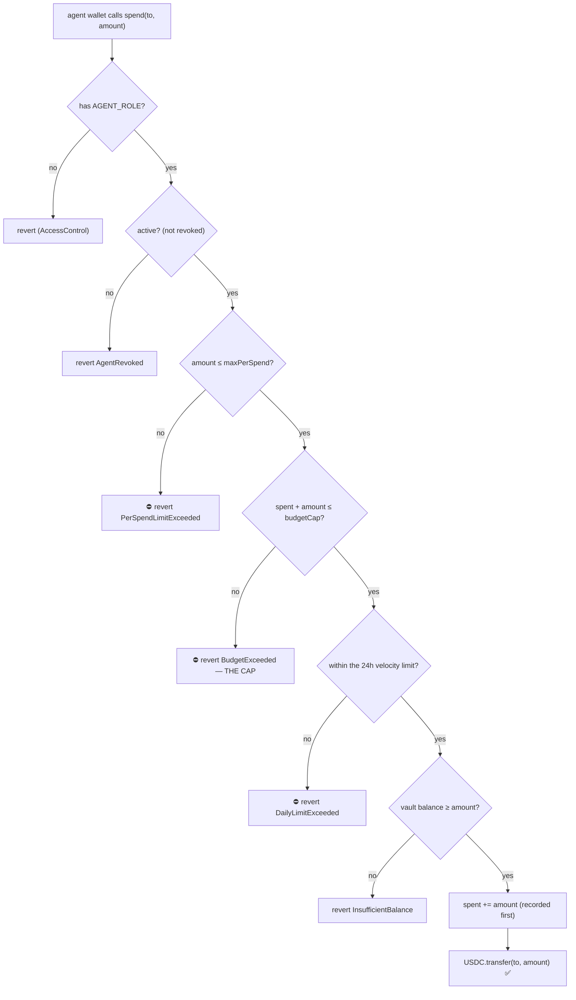

# How the spend cap works

The one question every reviewer asks: **how do you stop an AI agent from overspending — for real, not just on a dashboard?**

Short answer: **Arc has no built-in "spending limit." The cap is a Solidity contract we wrote and deployed on Arc** (`AgentVault.sol`). The limit is a contract invariant — `spend()` reverts above the cap — so there is nothing off-chain in the trust path to bypass. It would work the same on any EVM; Arc just makes USDC the native gas token, so the treasury, the spend, and the gas are all one asset.

---

## The core idea: the agent never holds the money

The USDC lives **inside the `AgentVault` contract**. The agent's wallet is granted only **`AGENT_ROLE`** — permission to *request* a spend. It cannot hold, move, or withdraw the treasury. The contract decides whether each spend is allowed.

> The limit is **inside the money**, not on a key or a server. Even a fully compromised agent key can spend at most the remaining budget, then every further `spend()` reverts.

---

## The state that defines the limit

```solidity
uint256 public budgetCap;   // lifetime ceiling, set by the human owner
uint256 public spent;       // cumulative spend, only ever increases
uint256 public maxPerSpend; // optional per-transaction ceiling (0 = off)
uint256 public dailyLimit;  // optional rolling 24h ceiling (0 = off)
bool    public active;      // human can freeze the agent
```

The invariant guaranteed after **any** sequence of calls: `spent ≤ budgetCap`, always.

---

## The gate — every check runs *before any money moves*

```solidity
function spend(address to, uint256 amount) external onlyRole(AGENT_ROLE) nonReentrant {
    if (to == address(0)) revert ZeroAddress();
    if (amount == 0) revert ZeroAmount();
    if (!active) revert AgentRevoked();

    // 1. per-transaction cap
    if (maxPerSpend > 0 && amount > maxPerSpend) revert PerSpendLimitExceeded(amount, maxPerSpend);

    // 2. lifetime budget cap  ← THE LIMIT
    uint256 remaining = budgetCap - spent;
    if (amount > remaining) revert BudgetExceeded(amount, remaining);

    // 3. rolling 24h velocity cap (window resets automatically)
    if (dailyLimit > 0) { /* … checks amount vs the 24h allowance, reverts DailyLimitExceeded … */ }

    // 4. the vault actually holds the funds
    uint256 bal = token.balanceOf(address(this));
    if (amount > bal) revert InsufficientBalance(amount, bal);

    spent = spent + amount;                 // effects BEFORE interaction (checks-effects-interactions)
    token.safeTransfer(to, amount - fee);   // …only now does money move
}
```

Three independent limits stack — **lifetime cap**, **per-transaction cap**, **24h velocity cap** — and each is a `revert`, not a flag.

---

## The decision flow



---

## Why it can't be bypassed

- **`onlyRole(AGENT_ROLE)` + Solidity `revert`** — there is no API to skip, no backend to bypass, no co-signer to phish. A stolen agent key, a hallucinating model, or a prompt injection all hit the same wall.
- **Checks-effects-interactions + `nonReentrant`** — `spent` is incremented *before* the transfer, so a re-entrant call can't double-spend.
- **Cap checked before balance** — the agent gets the meaningful `BudgetExceeded` error, not a generic transfer failure.
- **Separation of powers** — only the **human owner** (a different role) can `setCap` / `setMaxPerSpend` / `setDailyLimit` / `revoke` / `withdraw`. The agent can spend; it can never change its own limit or pull funds out.
- **The agent holds no raw key** — its wallet is a Circle developer-controlled (MPC) wallet, and it holds only gas dust, never the treasury.

---

## Proof

- **Tests:** `packages/contracts/test/AgentVault.t.sol` — 46 tests cover the over-budget revert, the per-transaction cap, the daily-limit revert + window reset, revoke/reinstate, withdraw, and access control. (`forge test` → 82 passing repo-wide.)
- **Live on Arc testnet:** a real over-cap spend, mined as a Failed transaction, decodes on the explorer to `PerSpendLimitExceeded(1500000, 1000000)` — [tx `0xc0d8b3…`](https://testnet.arcscan.app/tx/0xc0d8b3e5a3ab4aab483b9051cbc70869032fa2f191c44e14803c1511061cc27d). Regenerate one anytime with `bun --filter='@stablesettle/mcp' run x402:e2e` (offline) or `apps/mcp/scripts/revert-proof.ts` (live).

---

## How an owner sets the limits

| Limit | Set at spawn | Change later (owner, on-chain) |
|---|---|---|
| Lifetime budget | `spawn_agent budget=5000` | `setCap(newCap)` |
| Per-transaction cap | `spawn_agent maxPerSpend=500` | `setMaxPerSpend(limit)` |
| 24h velocity cap | — | `setDailyLimit(limit)` |
| Freeze / drain | — | `revoke()` · `withdraw(to, amount)` |

See [`docs/smart-contracts.md`](smart-contracts.md) for the full contract reference.
