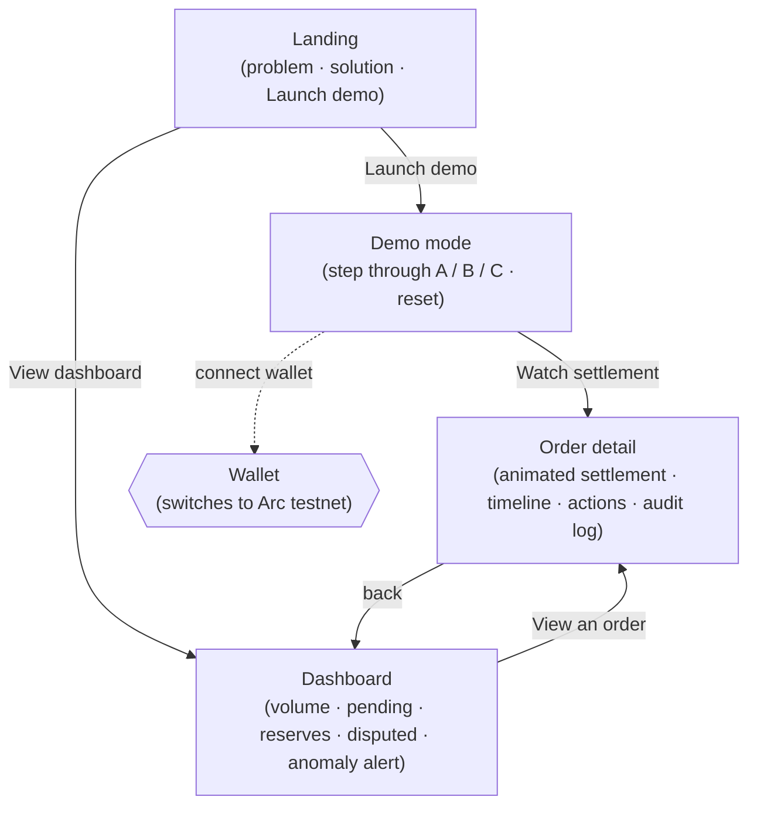
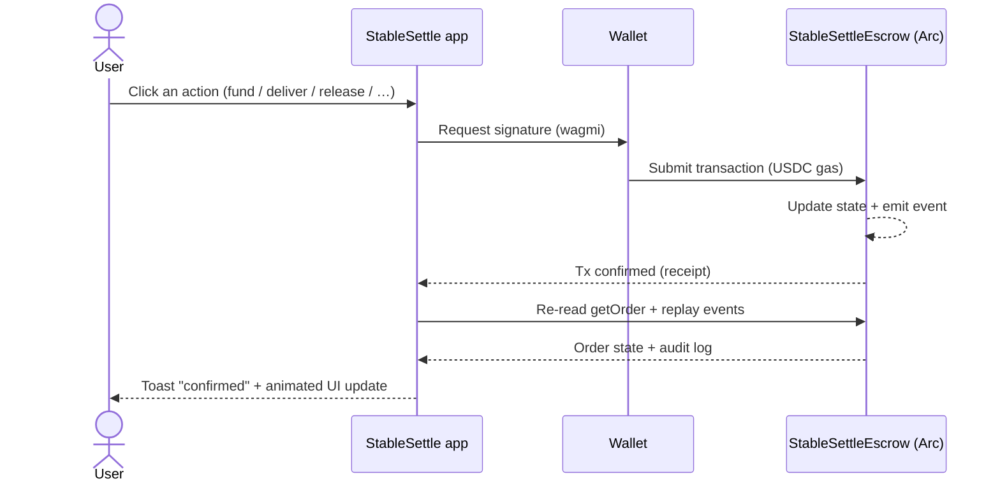
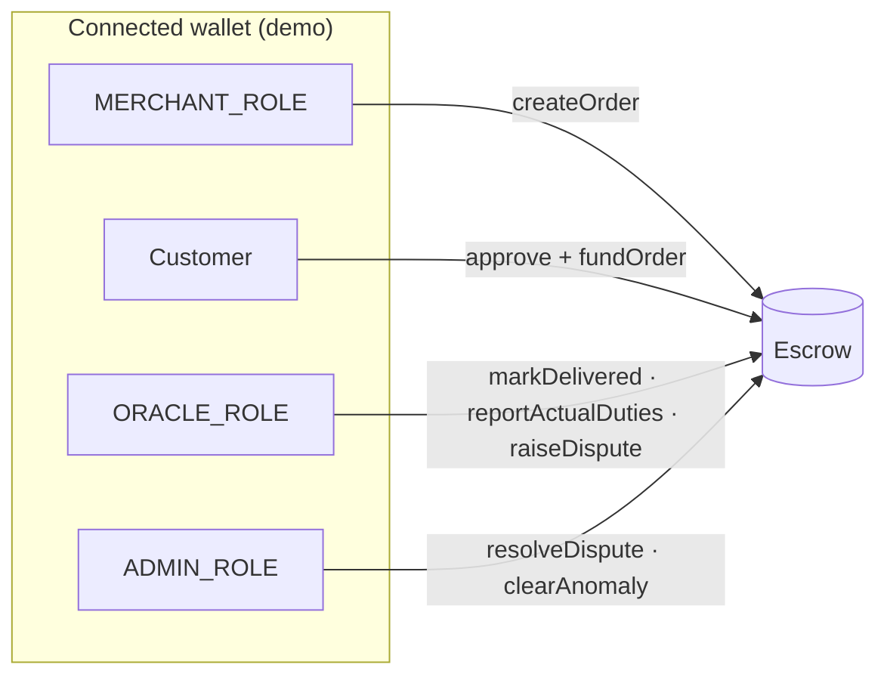
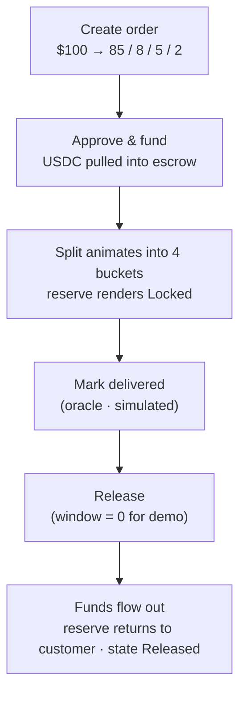
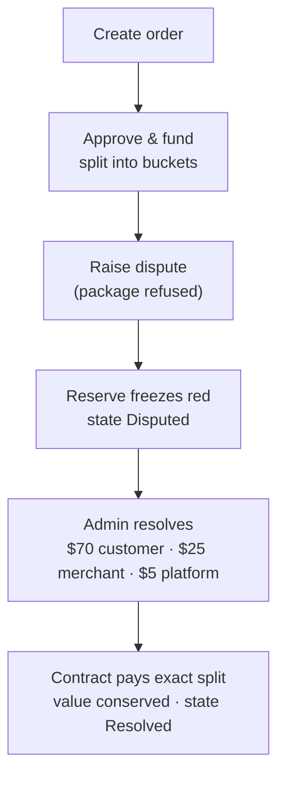
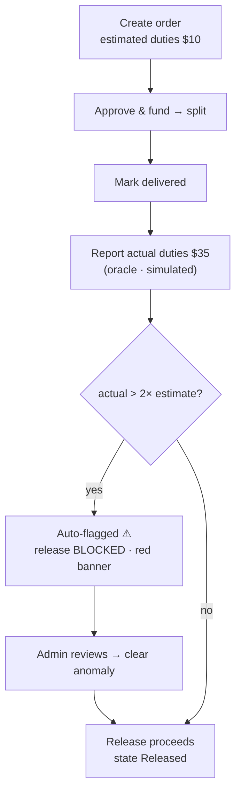
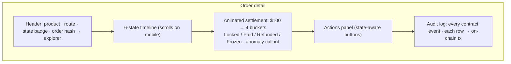

# StableSettle — User Flow

How a user moves through the app, from landing to a finalized settlement. All diagrams are
Mermaid (GitHub renders them inline). For the contract-level state machine see
[`smart-contracts.md`](smart-contracts.md); for the pitch beats see [`demo-script.md`](demo-script.md).

---

## 1. App navigation

The app is four screens. Everything reads live from contract events — there is no backend.

---

## 2. The core loop (any action)

Every button press follows the same shape: a real Arc transaction, then the UI re-reads
chain state and re-renders.

---

## 3. Roles in the demo

One connected wallet plays every role (the contract still *enforces* who can call what).

---

## 4. Scenario A — normal delivery

## 5. Scenario B — rejected package / dispute

## 6. Scenario C — duties anomaly

---

## 7. What the user sees on the order-detail centerpiece

Each audit-log row links to the transaction on `testnet.arcscan.app`, so a judge can verify
every step on-chain without leaving the app.
